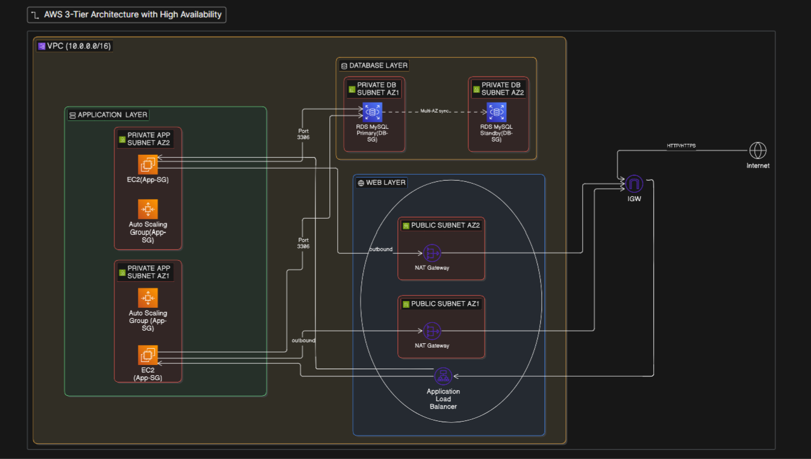
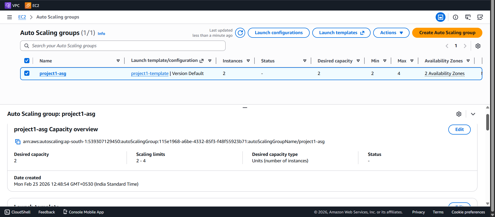
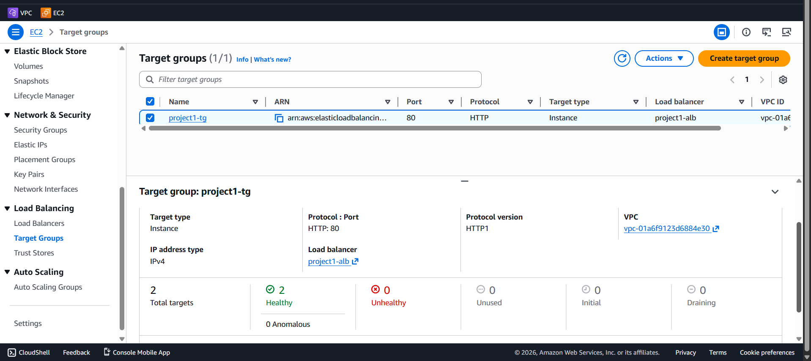
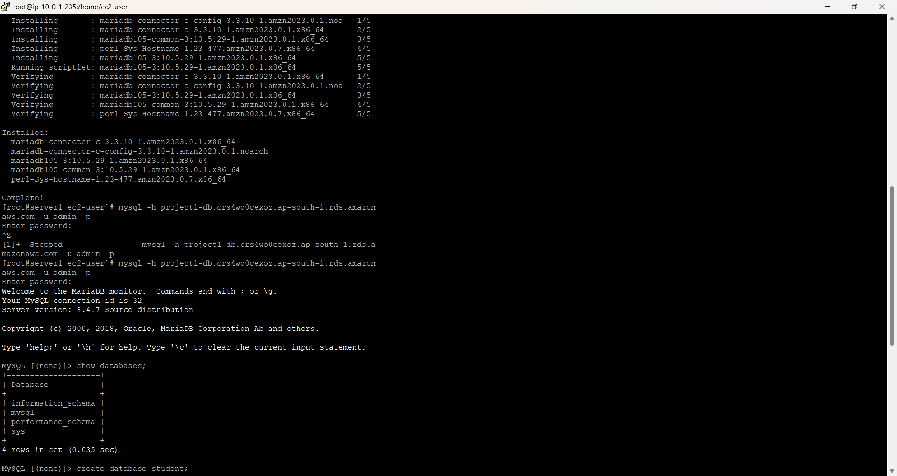
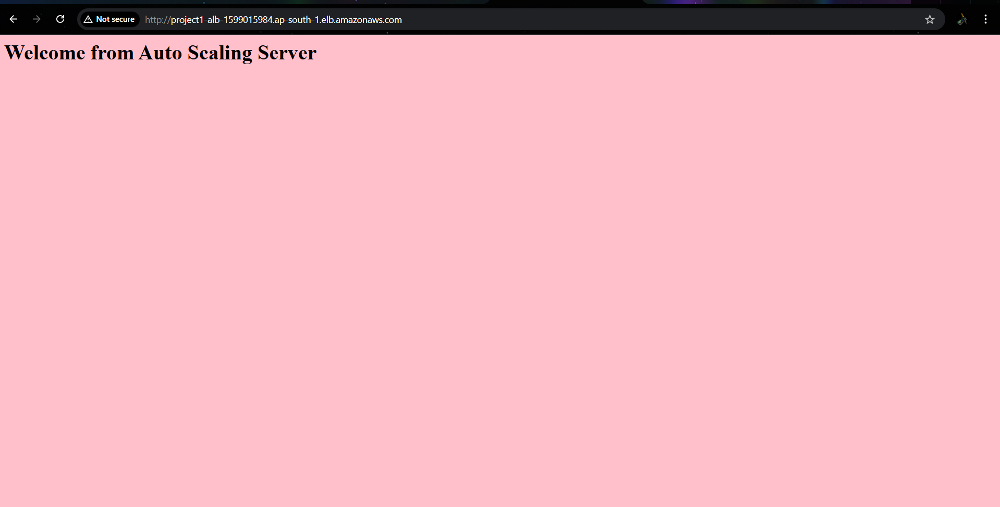

# AWS 3-Tier Architecture Project: Highly Available Web Application on AWS

In this project, we deploy a **secure and highly available 3-tier web architecture** on AWS. The application runs inside a custom VPC with public and private subnets spread across two Availability Zones, giving us high availability and fault tolerance.

Let's go! 🚀

## Architecture Diagram

**Traffic flow:**

User → Internet → Internet Gateway → Application Load Balancer
→ Auto Scaling EC2 (Private Subnets) → Amazon RDS

**Outbound access:**

EC2 → NAT Gateway → Internet

## Technologies Used

- **Amazon VPC**: custom network with public and private subnets
- **Amazon EC2 and Auto Scaling**: application servers that scale and self-heal
- **Application Load Balancer (ALB)**: distributes incoming traffic across instances
- **Amazon RDS (MySQL, Multi-AZ)**: managed database with automatic failover
- **Security Groups**: control traffic between each tier

## Prerequisites

- An AWS account
- Basic knowledge of AWS services (VPC, EC2, RDS, etc.)
- An IAM user with sufficient permissions to create and manage AWS resources

## Architecture Components

### Network Layer

- Custom VPC (`10.0.0.0/16`)
- 2 Availability Zones (`ap-south-1a`, `ap-south-1b`)
- 2 Public Subnets
- 2 Private Application Subnets
- 2 Private Database Subnets
- Internet Gateway
- NAT Gateway (outbound internet access from private subnets)

### Presentation Tier (Public Layer)

- Application Load Balancer (ALB)
- Accepts HTTP/HTTPS traffic from the Internet
- Distributes traffic across multiple EC2 instances

### Application Tier (Private Layer)

- EC2 instances deployed in private subnets
- Auto Scaling Group for high availability and scalability
- Instances do not have public IPs
- Outbound internet access through the NAT Gateway

### Data Tier (Database Layer)

- Amazon RDS MySQL (Multi-AZ)
  - Primary database in AZ1
  - Standby database in AZ2
- Database is deployed in private subnets
- Accessible only from EC2 instances (port 3306)

---

## Deployment Steps

### Step 1: Create a Custom VPC

Create a custom VPC with the CIDR block `10.0.0.0/16`. This is the isolated network that holds all three tiers.

### Step 2: Create Public and Private Subnets

Create six subnets across two Availability Zones (`ap-south-1a` and `ap-south-1b`):

| Subnet Type         | Count | Purpose                 |
| ------------------- | ----- | ----------------------- |
| Public              | 2     | ALB and NAT Gateway     |
| Private Application | 2     | EC2 instances           |
| Private Database    | 2     | RDS primary and standby |

### Step 3: Attach an Internet Gateway

Create an Internet Gateway, attach it to the VPC, and add a route in the public route table so the public subnets can reach the Internet.

### Step 4: Configure the NAT Gateway

Create a NAT Gateway in a public subnet and add a route to it in the private route table. This lets the EC2 instances in private subnets make outbound requests (for updates and packages) without being reachable from the Internet.

### Step 5: Create Security Groups

Create one security group per tier so that traffic is allowed only along the intended path:

| Security Group | Inbound Rule                                  |
| -------------- | --------------------------------------------- |
| ALB            | HTTP/HTTPS from the Internet                  |
| EC2            | Traffic only from the ALB security group      |
| RDS            | MySQL (3306) only from the EC2 security group |

### Step 6: Create a Launch Template

Create a Launch Template that defines the EC2 configuration (AMI, instance type, security group, and startup script) used by the Auto Scaling Group.

### Step 7: Configure the Auto Scaling Group

Create an Auto Scaling Group using the Launch Template and place it in the two private application subnets. The ASG keeps the desired number of instances running across both Availability Zones and replaces any that fail.

**Screenshot: Auto Scaling Group**

> The instances are running in private subnets and are spread across `ap-south-1a` and `ap-south-1b`.

### Step 8: Create the Application Load Balancer

Create an internet-facing Application Load Balancer in the two public subnets. It accepts HTTP/HTTPS traffic from the Internet and forwards it to the application tier.

### Step 9: Create the Target Group

Create a Target Group, register it with the ALB listener, and attach it to the Auto Scaling Group. The ALB uses health checks to send traffic only to healthy instances.

**Screenshot: Target Group Health**

> All targets show a **healthy** status, which confirms the ALB can reach the EC2 instances in the private subnets.

### Step 10: Launch Amazon RDS MySQL (Multi-AZ)

Launch an RDS MySQL instance with **Multi-AZ** enabled in the private database subnets. Set **Publicly accessible** to **No**, and use the RDS security group so only the EC2 instances can connect on port 3306.

**Screenshot: RDS Configuration**

> Multi-AZ is enabled (primary in AZ1, standby in AZ2) and the database is not publicly accessible.

### Step 11: Verify the Application Using the ALB DNS

Copy the DNS name of the Application Load Balancer, paste it into a browser, and confirm the application loads.

**Screenshot: Application Output**

> The application is reachable through the ALB DNS name and served by the EC2 instances in the private subnets. It works! 🚀

---

## Security

- EC2 instances are in private subnets (no public access)
- RDS is private and not publicly accessible
- Security Groups:
  - **ALB:** allows HTTP/HTTPS from the Internet
  - **EC2:** allows traffic only from the ALB
  - **RDS:** allows MySQL (3306) only from EC2
- Network isolation using public and private subnets

---

## Outcome

- Successfully deployed a highly available and scalable web architecture
- Implemented a secure network design using private subnets
- Achieved fault tolerance using a Multi-AZ deployment
- Demonstrated core AWS architecture best practices

---

## Skills Demonstrated

- Amazon VPC
- EC2
- Auto Scaling
- Application Load Balancer
- Amazon RDS
- Networking and Security
- High Availability Architecture
- Cloud Deployment

---

## Documentation and Best Practices

Throughout the project, each step was documented along with the configuration choices made. This helps with maintenance and makes it easier to scale or adjust the architecture later.

This project is a foundational experience in designing a secure, highly available multi-tier application on AWS. It can be extended in the future, for example with HTTPS using ACM, CloudWatch monitoring, or Infrastructure as Code with Terraform.

---
